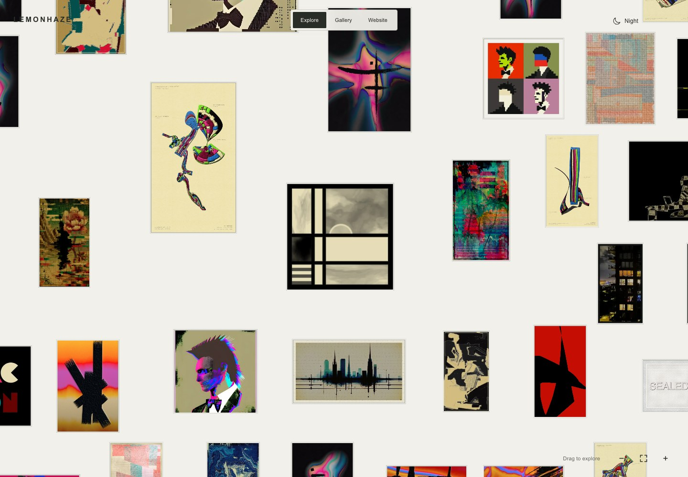
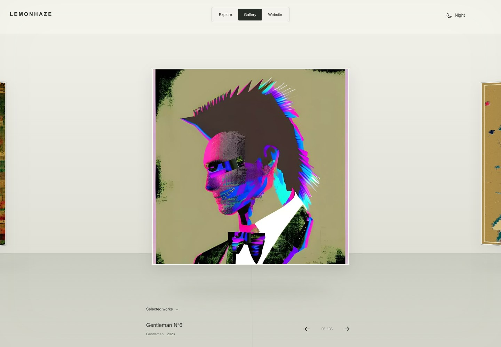
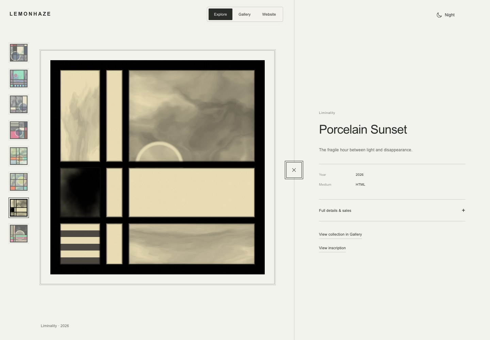
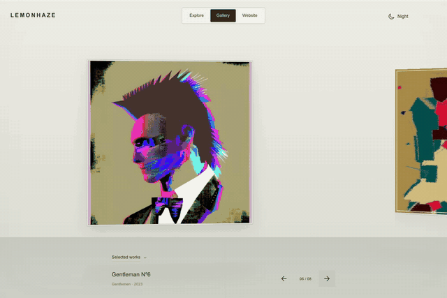

# lemonhaze.com

An artist portfolio where the archive is also an interface: a draggable field of original works, an immersive collection carousel, and an editorial website connected by one continuous navigation system.

[Explore the live site](https://lemonhaze.com) · [Visual tour](docs/presentation/README.md) · [Architecture](docs/ARCHITECTURE.md) · [Documentation](docs/README.md)



*Explore up close. Zoom out to reveal the entire archive as a lemon-shaped field.*

| Gallery | Artwork detail |
| --- | --- |
|  |  |
| A circular exhibition with drag, swipe and center snapping. | Native proportions, quiet framing, live artwork and expandable context. |

## Portfolio presentation

[Latest interaction and Website presentation refinements](docs/reports/2026-11-12-interaction-polish.md) include the framed Gentleman Nº1 landing, animated mode switch, lemon throws and embedded inscription notes.

The visual system keeps the artwork in charge: a restrained palette, consistent wordmark, generous framing and a shared Explore / Gallery / Menu switch. Custom interaction work connects those views without losing the selected artwork or collection.

The engineering supports that presentation: bounded image loading, cancellable quality upgrades, stable live-canvas fitting, native pixel rendering, URL-backed navigation and reduced-motion paths. The [visual tour](docs/presentation/README.md) pairs desktop and mobile screenshots with implementation and regression-test references.

<details>
<summary>Watch the Gallery move — short animated preview</summary>



*Real browser capture at normal speed; the GIF is reduced in resolution and frame rate for GitHub. The [live Gallery](https://lemonhaze.com/?view=gallery) is the reference for motion and artwork quality.*

</details>

**Latest application release:** November 12, 2026, source [54a5fef](https://github.com/byLemonhaze/lemonhaze.com/commit/54a5fef4e1f2d81d65782155997c885c56fac672). [Integration PR #67](https://github.com/byLemonhaze/lemonhaze.com/pull/67) · [Immutable deployment](https://d1310231.lemonhaze.pages.dev) · [Release and live-check record](docs/reports/2026-11-12-interaction-polish.md) · [Changelog](CHANGELOG.md).

`main` is the integration branch. The [November 11 work report](docs/reports/2026-11-11.md) preserves the initial immersive release history; the changelog records later refinements and content additions.

## Site experience

- **Explore:** 1,414 original works in a draggable, zoomable lemon-shaped field. Desktop retains the approved close-up composition; phones start with the full lemon. Wall pressure and rebound move the whole field as one group.
- **Gallery:** an infinite carousel with native artwork proportions, drag/swipe, trackpad movement and centre snapping. One collection chooser includes the selected eight works and complete collection groups.
- **Website:** an editorial landing and a right-hand Menu. Selected Work, Practice, About, Exhibitions, All Works, Studio Notes, Collecting, Print Shop and Lab retain their destination pages. The former homepage carousel is retired.
- **Artwork details:** one artwork beside metadata, a collection rail and expandable full details/sales. Desktop artwork clicks open a near-full-screen solo view; × or Escape restores the same split. Mobile detail fits the viewport independently of Explore zoom.
- **Shared presentation:** one stable wordmark, mode switch and persistent Day/Night control. Artwork colors and aspect ratios are preserved. System reduced-motion preferences remain supported.

All Works stays collection-first, with title search returning actual matching artworks and artist-selected covers. It includes three public Ethereum releases with locally hosted animations and on-site detail views. “Provenance” is not a public collection; parent inscriptions and lineage records remain available. Gentleman Nº1 is identified as the master parent of the on-chain tree.

## Documentation

Start with the [documentation index](docs/README.md). Current guides:

| Guide | Purpose |
| --- | --- |
| [Architecture](docs/ARCHITECTURE.md) | Application, routing, services and source map |
| [Immersive architecture](docs/immersive/ARCHITECTURE.md) | Navigation contracts, composition, media and motion |
| [Data sources](docs/DATA-SOURCES.md) | Catalogue, curation, image derivatives and sales data |
| [API](docs/API.md) | Public, private and shop endpoints |
| [Deployment](docs/DEPLOYMENT.md) | Verification, preview/production targets and live checks |
| [Verification](docs/immersive/VERIFICATION.md) | Latest test evidence and limits |
| [Print Shop](docs/SHOP.md) | Closed storefront, payment readiness and operations |
| [Follow-up tracker](docs/TRACKING.md) | Outstanding checks and maintenance rules |

[Feedback passes](docs/immersive/README.md) and earlier audits are dated history, not competing current specifications.

## Development

Node 22 is pinned in `.nvmrc`. The main site uses modular vanilla JavaScript, Vite 6 and Tailwind CSS 3. Market Watch is a lazily loaded React module. Cloudflare Pages serves static/prerendered routes and Functions.

```bash
nvm use
npm ci
npx playwright install chromium
npm run dev
```

```bash
npm run build       # data/title generation, Vite, then route prerendering
npm run preview     # preview dist; does not emulate Pages Functions
npm run verify      # production build and the complete test suite
```

The November 12 application release checks passed **255 tests** and generated **1,704 routes**. [Verification](docs/immersive/VERIFICATION.md) records the exact release, live checks, earlier Chromium/WebKit evidence and testing limits. These are dated results, not a code-coverage percentage or permanent expected counts.

## Routes

| Address | Behavior |
| --- | --- |
| `/` or `/?view=explore` | Explore landing |
| `/?view=explore&at=<id>` | Explore field focused on a work, without detail |
| `/?view=explore&work=<id>` | Explore artwork detail |
| `/?view=gallery&series=<name>&at=<id>` | Gallery collection centred on a work |
| `/?view=website` | Website home, with no inherited artwork modal |
| `/<collection-slug>` / `/<inscription-id>` | Existing collection / artwork deep links |
| `/selected`, `/practice`, `/archive`, `/collecting`, `/all-works` | Editorial and catalogue destinations |
| `/visualizer/` | Full visual chronology; distinct from Explore’s original-only field |

Legacy query aliases remain supported. `/explore` is the historical editorial alias for `/practice`, **not** the immersive Explore route. `/provenance` redirects to `/all-works`.

## Publishing

Only publish when authorized; see the [deployment runbook](docs/DEPLOYMENT.md).

```bash
npx wrangler whoami
npm run verify
npx wrangler pages deploy dist --project-name lemonhaze --branch main
```

Use `--branch immersive-review` for a preview. Always specify the target explicitly.

## Shop and privacy

The public shop is **browsing-only: Price on request / Coming soon**. Its Stripe and inventory backend exists, but this site release does not authorize or enable purchases. Follow [SHOP.md](docs/SHOP.md) before changing launch gates. Public contact remains `collect@lemonhaze.com`, Montréal, Canada. Never commit private contact details, credentials or customer data.

Maintainer: [@byLemonhaze](https://github.com/byLemonhaze).
