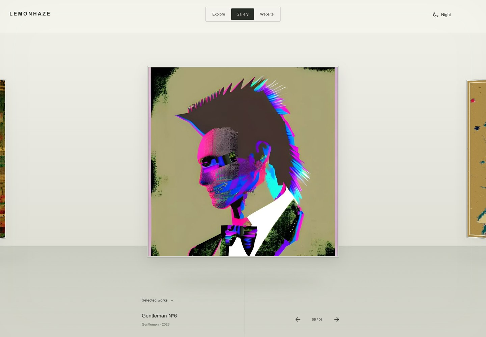

# Documentation index

Current publication status: [release verification](immersive/VERIFICATION.md). This index separates current operating guides from point-in-time implementation records.

**Start visually:** the [portfolio tour](presentation/README.md) shows Explore, Gallery, artwork detail, day/night presentation and mobile, with a short motion preview and links to the implementation.

## Current guides

| Document | Contents |
| --- | --- |
| [Visual portfolio tour](presentation/README.md) | Screenshots, interaction preview, design decisions and engineering evidence |
| [Project overview](../README.md) | Experience, local development, routes and release pointer |
| [Architecture](ARCHITECTURE.md) | Runtime, routing, editorial, service and build boundaries |
| [Immersive architecture](immersive/ARCHITECTURE.md) | Explore, Gallery, detail/solo, media and state handoffs |
| [Data sources](DATA-SOURCES.md) | Authoritative records, cover choices, media assets, sales ledger |
| [API](API.md) | Endpoint inventory, authentication and launch gates |
| [Deployment](DEPLOYMENT.md) | Explicit production/preview targets and verification workflow |
| [Verification](immersive/VERIFICATION.md) | Current release evidence and testing limits |
| [Shop](SHOP.md) | Browsing-only storefront and separate commerce readiness |
| [Social previews](social-previews.md) | Sharing image generation and metadata |
| [Tracking](TRACKING.md) | Remaining checks and recurring maintenance |
| [Contributing](../CONTRIBUTING.md) | Change and documentation requirements |
| [Security](../SECURITY.md) | Reporting and implemented security boundaries |

## Release history and review evidence

- [November 13 mobile bounce report](reports/2026-11-13-mobile-bounce.md): touch capture, contained rebounds, release continuity and phone viewport checks.

- [November 12 interaction and presentation report](reports/2026-11-12-interaction-polish.md): accepted local design study, content refinements, embedded notes and release checks.

- [Changelog](../CHANGELOG.md): concise release-facing changes.
- [November 11 work report](reports/2026-11-11.md): today’s scope, commit milestones, final release and limits.
- [Immersive feedback index](immersive/README.md): the original passes in order, with their screenshots and test records.
- [Current presentation screenshots and motion preview](presentation/README.md), captured from production on November 12.
- [November 11 screenshot review](../output/playwright/feedback-18/index.html). GitHub displays the HTML source; open the individual PNGs in that folder, or open the index locally to browse the gallery.
- [Archive review](archive-local-review.md), [SEO review](seo-local-review.md), [Shop audit](SHOP-AUDIT.md), and [reference observations](immersive/REFERENCE-OBSERVATIONS.md) preserve their original point-in-time findings. Counts and release statements there may have been superseded.
- [Editorial source credits](../public/editorial/sources.md) retain source attribution for existing writing and media.

## Keeping this useful

Update the relevant current guide when behavior changes. Add a dated report or changelog entry for a meaningful release, including the source commit, verification actually run, deployment URL and remaining limits. Do not turn a historical “not deployed” review into a claim about the current site. Keep production deployment status separate from Git branch/merge status.
