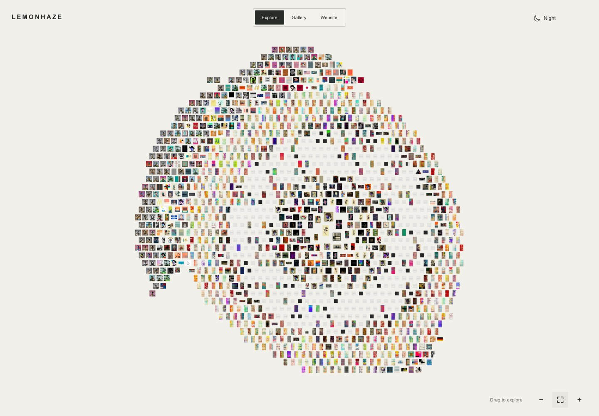
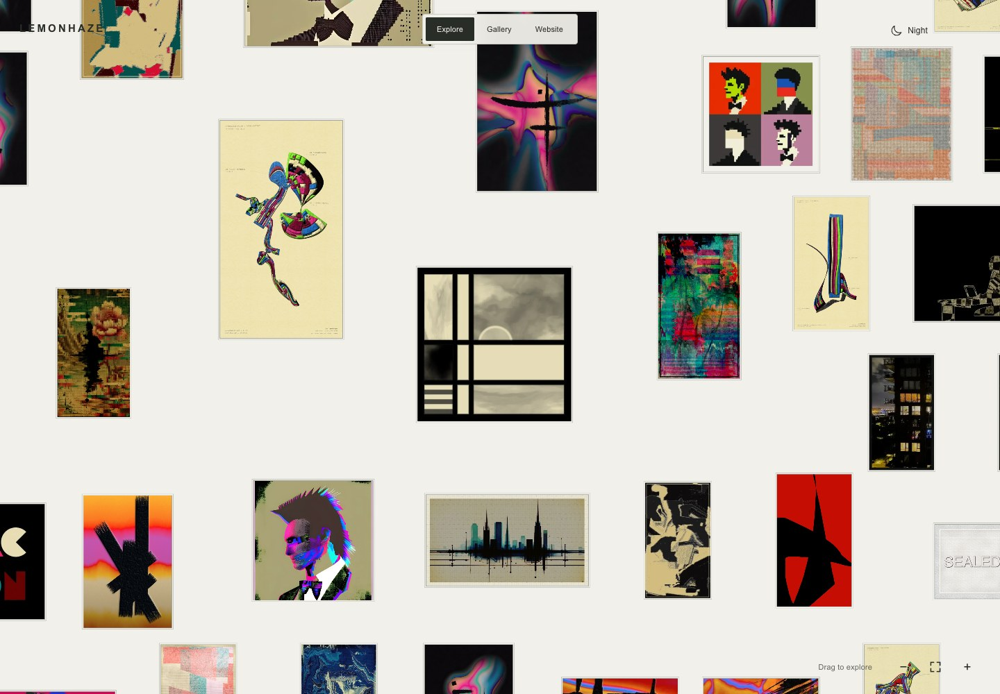
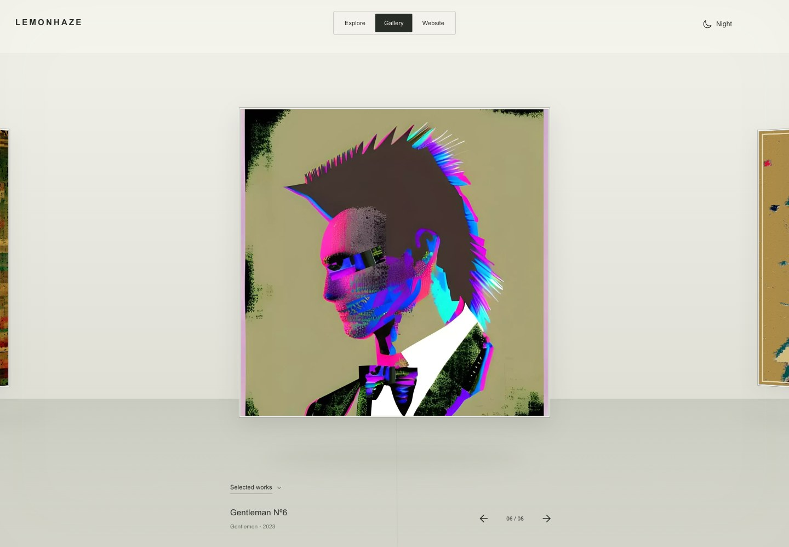
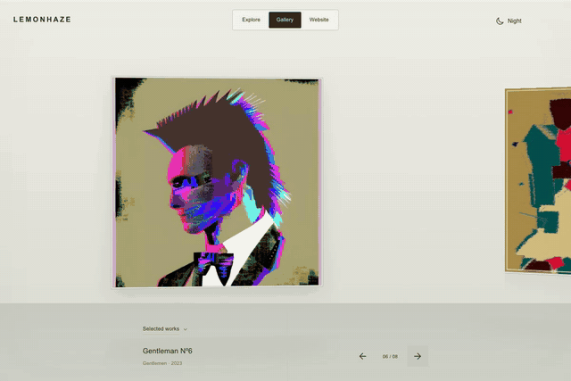
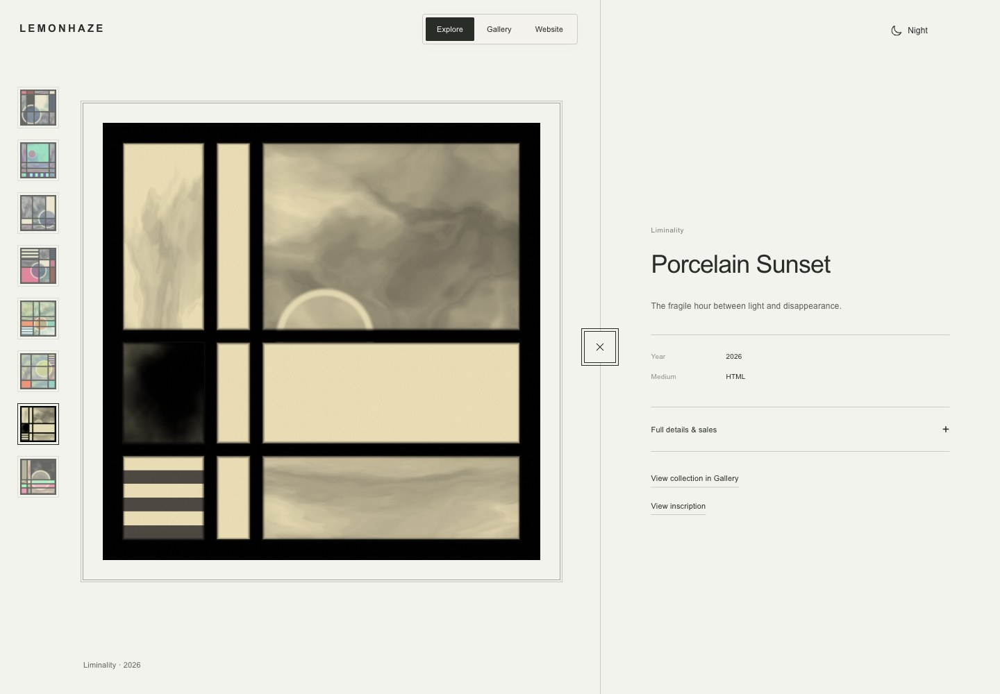
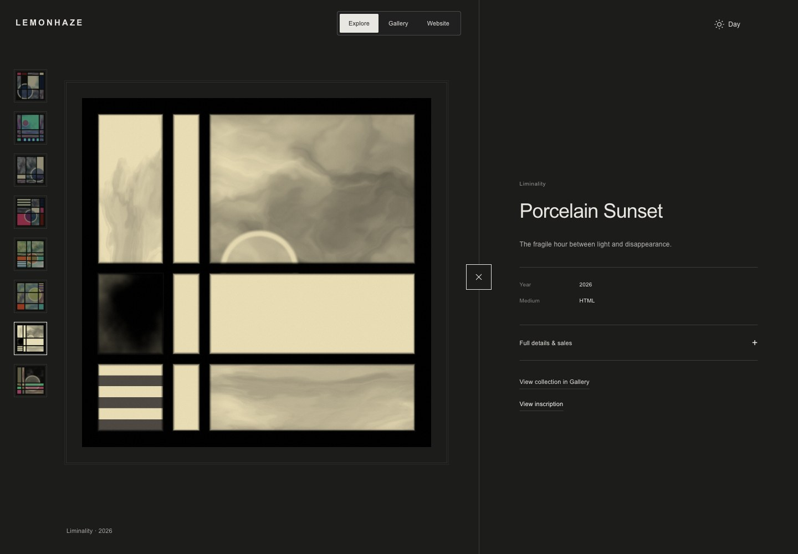
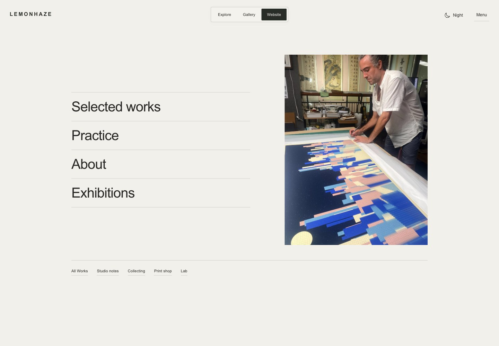
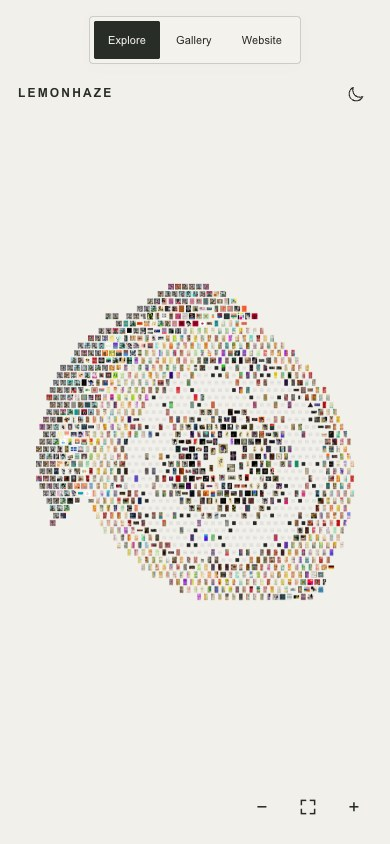
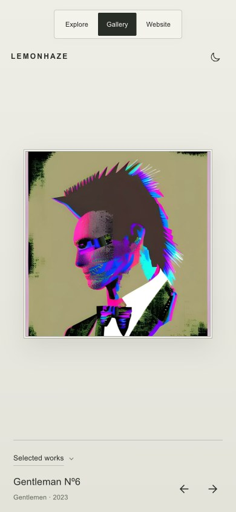

# A portfolio you can move through

[Visit lemonhaze.com](https://lemonhaze.com) · [Project README](../../README.md) · [Documentation index](../README.md)

The site presents Lemonhaze’s practice at three scales: an entire body of work, an individual exhibition, and the context around an artwork. Explore, Gallery and Website share the same navigation and visual language, while each offers a different way to look.

## Explore: the archive as a composition

From a distance, the works form a lemon. Up close, the field becomes a composition of individual artworks with their original aspect ratios. Dragging, zooming and wall-pressure deformation act on the field as one group; the artwork images remain intact.

Desktop opens within the curated center. Mobile opens with the whole lemon so the collection is legible before the visitor chooses where to zoom.

## Gallery: movement with a resting point

The Gallery is a continuous collection carousel. Drag, swipe, trackpad, arrows and keyboard all lead to the same centered resting position. A single collection chooser changes the exhibition; original artwork proportions determine each frame.

Play a short Gallery motion preview

The loop records real next/previous controls, including their settling motion. It is downsampled to 640 pixels wide and 14 frames per second for repository browsing; it is not a performance benchmark. [Open the live Gallery](https://lemonhaze.com/?view=gallery) for the full-quality interaction.

## Detail: artwork first, context alongside

The collection rail keeps nearby works accessible while metadata and sales details occupy the right pane. On desktop, clicking the artwork enters a solo view and returns to the same detail state. Large previews resolve into sharp stills through a brief focus transition; native pixel art skips the blur, and live HTML/video playback has its own readiness path.

Day and night change the surrounding presentation, not the artwork’s colors. The shared wordmark and mode switch stay in place across views.

## Website: the practice beyond individual works

The editorial home connects Selected Work, Practice, About and Exhibitions with All Works, Studio Notes, Collecting, Print Shop and Lab. It gives the archive a wider context without repeating the immersive carousel.

## Mobile: overview and focused viewing

| Explore landing | Gallery |
| --- | --- |
|  |  |

The mobile field starts zoomed out. Gallery reserves space for the shared navigation and caption, while artwork detail uses its own viewport independently of the Explore camera. These are responsive browser captures, not photographs of a physical device.

## Design decisions and engineering evidence

| Visible behavior | Implementation | Regression evidence |
| --- | --- | --- |
| One field that pans, zooms and responds to wall pressure | [Explore](../../src/immersive/explore.js), [field physics](../../src/immersive/field-physics.js) | [Field tests](../../tests/immersive-field.test.mjs), [zoom tests](../../tests/immersive-zoom.test.mjs) |
| Circular Gallery with a centered resting position | [Gallery](../../src/immersive/gallery.js), [motion](../../src/immersive/gallery-motion.js) | [Navigation and interaction tests](../../tests/immersive-navigation.test.mjs) |
| Sharp images without a hard quality cut | [Media queue](../../src/immersive/media.js), [focus reveal](../../src/immersive/focus.js) | [Media tests](../../tests/immersive-media.test.mjs), [focus tests](../../tests/immersive-focus.test.mjs) |
| Stable live artwork inside consistent framing | [Live document bridge](../../src/immersive/live-document.js), [detail view](../../src/immersive/detail.js) | [Resize stability](../../tests/immersive-focus.test.mjs), [presentation tests](../../tests/immersive-presentation.test.mjs) |
| Mobile layout, preserved proportions and reliable first paint | [Presentation](../../src/immersive/presentation.js), [experience styles](../../src/immersive/experience.css) | [Mobile tests](../../tests/immersive-mobile.test.mjs), [startup tests](../../tests/immersive-startup.test.mjs) |

The November 12 application release passed **250 tests** and generated **1,704 routes**. These counts describe that release, not a percentage of code coverage. [Verification](../immersive/VERIFICATION.md) records the production checks and limits; [Architecture](../immersive/ARCHITECTURE.md) explains state, media and interaction contracts.

## Capture record and maintenance

- Captured from **https://lemonhaze.com** on **November 12, 2026**, following application release [f73ae62](https://github.com/byLemonhaze/lemonhaze.com/commit/f73ae62b7a65be97fd63c0b91625f3af7b04154a), deployed as [ff70bf7f](https://ff70bf7f.lemonhaze.pages.dev).
- Still screenshots: Chromium, 1440 × 1000 desktop and 390 × 844 mobile viewport. Gallery recording: 1200 × 800, normal playback speed; reduced only for the GIF export. Screenshots show actual UI without compositing or invented content.
- Images are compressed documentation copies, not artwork masters. The animated preview is collapsed by default so visitors can choose whether to view motion.
- These assets live under `docs/presentation/assets/` and are not part of the production site bundle. Older review screenshots remain historical evidence in `output/playwright/`.
- When the interface changes, recapture the affected view, inspect the resulting file, update this date and release reference, and keep captions and source/test links aligned. Preserve artwork proportions and avoid screenshots captured before media has loaded.

Artwork, photographs and site presentation by Lemonhaze.

## November 12 interaction and Website update

The [session report](../reports/2026-11-12-interaction-polish.md) includes the chosen framed Gentleman Nº1 homepage, anchored Gallery picker and embedded inscription notes. Those captures document the later pass; the production tour above remains a dated record of the earlier release.
