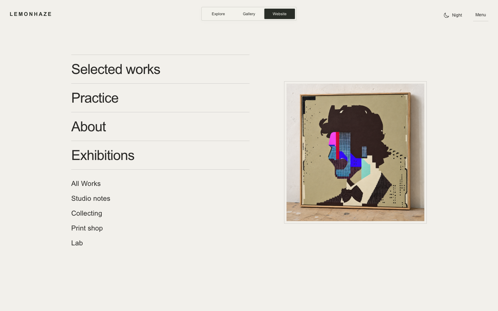
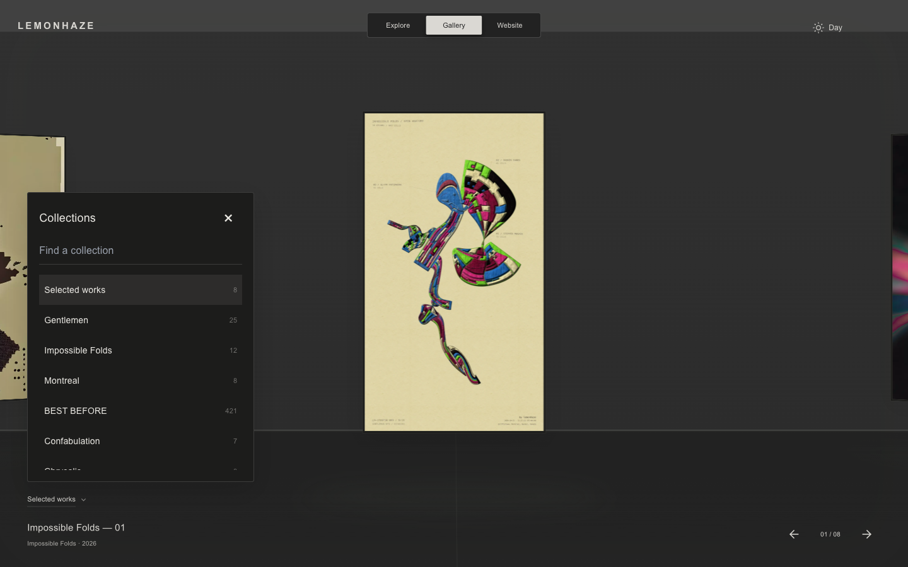
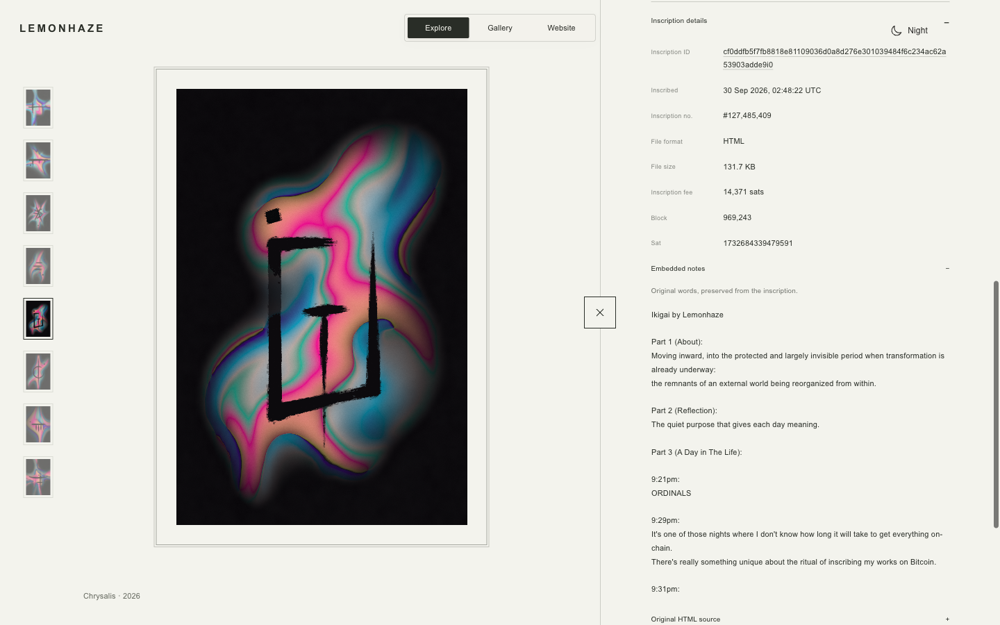

# November 12, 2026 — Interaction and Website presentation

This pass takes the artist's local interaction studies into the existing site: a slimmer squared mode bar, a more throwable lemon overview, and a theme-aware solo room. It also refines navigation placement and restores access to words embedded in inscription HTML. Existing editorial wording, original artwork assets and collection routes remain intact.

## Accepted presentation

The homepage uses the exact supplied `ChatGPT Image Nov 12, 2026, 09_00_55 PM.png`, copied without modification to `public/editorial/gentleman-01-framed.png`. It is a generated workbench presentation study, not documentary photography. Later angle, lighting, canvas and tone trials were rejected and excluded from the published assets. The photo has a quiet outer border; All Works, Studio notes, Collecting, Print shop and Lab now sit vertically beneath Exhibitions.

The Good Night signing photograph replaces the workstation image introducing Studio Notes. Original note entries remain available. In Practice, year labels align with their artwork rows. All Works intentionally repeats the original cover three times for Satoshi and Deprivation Prints; this does not create duplicate artwork or edition entries in Explore.

## Interaction decisions

- **Mode switch:** original squared silhouette, 40px desktop / 44px mobile height, spring indicator and restrained mouse attraction on lettering. Links remain stationary; keyboard and reduced-motion behavior are retained.
- **Explore overview:** the whole field can be thrown with recent pointer velocity. Stronger rebound and lower resistance use substepped simulation, with stable collision bounds independent of visible deformation. Close-up composition and panning are unchanged.
- **Solo view:** the artwork, live surface and mat move together over 760ms. The room opens in paper by day or charcoal by night. Shared controls retreat and become inert, then return on close. Interrupted transitions and reduced motion are handled.
- **Desktop Gallery:** collection/title at bottom left, navigation at bottom right; the center stays clear. Its collection picker is anchored above the left control, rather than centered over the art. Mobile retains its own dialog layout. This pass does not retune Gallery scrolling physics.
- **Control styling:** Gallery focus outlines are transparent at the artist's request. Keyboard operation remains, with selection highlighting and title underlining; this is a deliberate visual tradeoff rather than a claim of complete accessibility conformance.

## Embedded inscription notes

The final location is **Full details & sales → Inscription details → Embedded notes**. Its label matches the small metadata typography. Opening it retrieves the original HTML on demand and displays comment text without executing the artwork or rewriting its words. An optional Original HTML source disclosure retains access to the complete source. Failures can be retried by closing/reopening; switching works aborts the request and prevents stale text from entering the next work. Static-only Old Fashioned pieces do not fetch chain source.

Ikigai was checked against its live inscription: About, Reflection and A Day in The Life were readable in the panel. External inscription availability remains a dependency; no guaranteed offline archive is implied.

## Validation and publication

`npm run verify` on Node 22 passed: **1,704 prerendered routes and 253 tests, zero failures**. Production publication awaits the required GitHub check and main integration; the release record will be completed after deployment.

Local visual review covered the exact chosen home image, desktop Practice year alignment, the notes nested under Inscription details, and mobile Website navigation. Regression coverage includes lazy source loading, preservation of multilingual text, script non-execution, reuse after closing/reopening, and stale-request cancellation.

The wall-release browser regression now observes the actual recovery away from the contact point. Its previous fixed 1.2-second sample could coincide with a new opposite-wall collision under the accepted stronger throw; the assertion still requires both restored proportions and rebound movement.

No changes were made to catalogue.gallery, commerce gates, databases or purchase availability. Browser emulation does not replace hands-on device review.
