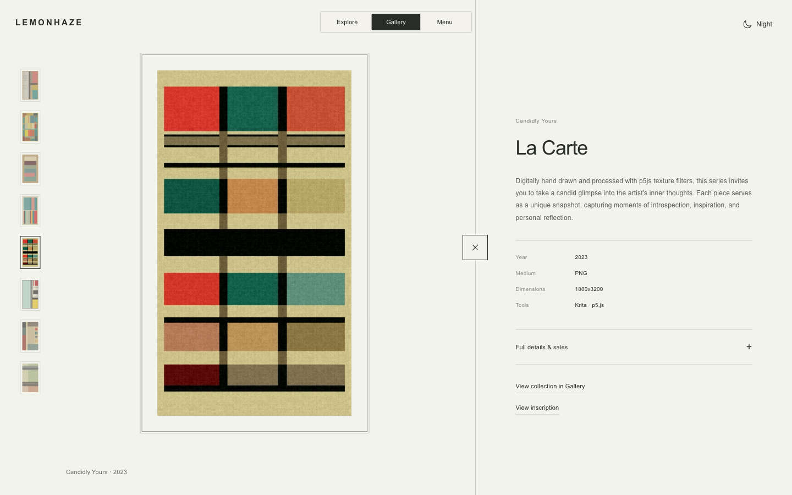

# November 12, 2026 — Interaction and Website presentation

This pass takes the artist's local interaction studies into the existing site: a slimmer squared mode bar, a more throwable lemon overview, and a theme-aware solo room. It also refines navigation placement and restores access to words embedded in inscription HTML. Existing editorial wording, original artwork assets and collection routes remain intact.

## Accepted presentation

The homepage uses the exact supplied `ChatGPT Image Nov 12, 2026, 09_00_55 PM.png`, copied without modification to `public/editorial/gentleman-01-framed.png`. It is a generated workbench presentation study, not documentary photography. Later angle, lighting, canvas and tone trials were rejected and excluded from the published assets. The photo has a quiet outer border; All Works, Studio notes, Collecting, Print shop and Lab now sit vertically beneath Exhibitions.

The Good Night signing photograph replaces the workstation image introducing Studio Notes. Original note entries remain available. In Practice, year labels align with their artwork rows. All Works intentionally repeats the original cover three times for Satoshi and Deprivation Prints; this does not create duplicate artwork or edition entries in Explore.

## Interaction decisions

- **Navigation:** the center bar now reads Explore / Gallery / Menu. Menu returns to the Website index from any view or page; the duplicate top-right trigger is retired, and day/night occupies that far-right position. All Works retains year navigation and Visual chronology; Privacy, Terms & contact, X and Discord sit in a quiet footer beneath the index content. Explore and Gallery have no footer. Existing URLs still use `view=website`.
- **Mode switch:** original squared silhouette, 40px desktop / 44px mobile height, spring indicator and restrained mouse attraction on lettering. Links remain stationary; keyboard and reduced-motion behavior are retained.
- **Explore overview:** the whole field can be thrown with recent pointer velocity. Stronger rebound and lower resistance use substepped simulation, with stable collision bounds independent of visible deformation. Close-up composition and panning are unchanged.
- **Solo view:** the artwork, live surface and mat move together over 760ms. The room opens in paper by day or charcoal by night. Shared controls retreat and become inert, then return on close. Interrupted transitions and reduced motion are handled.
- **Desktop Gallery:** collection/title at bottom left, navigation at bottom right; the center stays clear. Its collection picker is anchored above the left control, rather than centered over the art. Mobile retains its own dialog layout. This pass does not retune Gallery scrolling physics.
- **Control styling:** Gallery focus outlines are transparent at the artist's request. Keyboard operation remains, with selection highlighting and title underlining; this is a deliberate visual tradeoff rather than a claim of complete accessibility conformance.

## Embedded inscription notes

The final location is **Full details & sales → Inscription details → Embedded notes**. Its label matches the small metadata typography. Opening it retrieves the original HTML on demand and displays comment text without executing the artwork or rewriting its words. An optional Original HTML source disclosure retains access to the complete source. Failures can be retried by closing/reopening; switching works aborts the request and prevents stale text from entering the next work. Static-only Old Fashioned pieces do not fetch chain source.

Ikigai was checked against its live inscription: About, Reflection and A Day in The Life were readable in the panel. External inscription availability remains a dependency; no guaranteed offline archive is implied.

## Final media corrections

Candidly Yours exposed an original p5 wrapper whose resize handler changes drawing coordinates without resizing its canvas buffer. HTML artwork now keeps a stable logical viewport while the outer viewer scales it to fit split, solo and resized windows. The original artwork code stays intact; its live surface and poster remain centered together.

Boulogne, Rich Bean and Marilyn Monero open in the site's split viewer from All Works, including title-search results and direct links. Their public animations are mirrored locally (two GIFs and one animated WebP) and replace the static browsing previews after decoding. Token details retain contract, token ID, chain, edition and an optional OpenSea link. Rich Bean uses its public 176 × 208 GIF, not the collector-only video or soundtrack. [Media sources](../../public/images/ethereum/SOURCES.md) record exact origins. Bell Street Style and Murky are excluded from public listings while their historical source records are retained. Public artwork titles omit the former “by TOKΞNIZΞD” suffix at the artist’s request. The approved Explore composition is unchanged.

## Validation and publication

The production build and complete test suite on Node 22 passed: **1,704 prerendered routes and 254 tests, zero failures**. Published to [lemonhaze.com](https://lemonhaze.com) from source [243103e](https://github.com/byLemonhaze/lemonhaze.com/commit/243103e249b90f6f040190e935536538ee939af0). Immutable deployment: [6a9e2562.lemonhaze.pages.dev](https://6a9e2562.lemonhaze.pages.dev). [PR #67](https://github.com/byLemonhaze/lemonhaze.com/pull/67) records required GitHub verification and protected-main integration. Cloudflare’s `main` deployment label is distinct from that source integration.

Live checks confirmed all three Ethereum originals animate in the on-site viewer, with the cleaned titles. La Carte retained its 675 × 1200 logical viewport and 1350 × 2400 drawing buffer through split → solo → split; the returned live and poster bounds matched exactly (353.25 × 628 CSS px). The homepage asset SHA-256 matches the supplied file (`12afbae7840699cdc40217edd6e4bbd6c880a5092a11df1b529ce6a8f37582ce`); published `main-BG8nAgIs.js` and `experience-C9YnJ7nE.js` references match the verified build.

Local visual review covered the exact chosen home image, desktop Practice year alignment, the notes nested under Inscription details, and mobile Website navigation. Regression coverage includes lazy source loading, preservation of multilingual text, script non-execution, reuse after closing/reopening, and stale-request cancellation.

GitHub's moving `ubuntu-latest` runner selected Ubuntu 26.04, which the locked Playwright 1.58.2 dependency cannot install on. CI is pinned to supported Ubuntu 24.04 so the same browser checks run reproducibly; no checks were removed or bypassed.

The wall-release browser regression now observes the actual recovery away from the contact point. Its previous fixed 1.2-second sample could coincide with a new opposite-wall collision under the accepted stronger throw; the assertion still requires both restored proportions and rebound movement.

No changes were made to catalogue.gallery, commerce gates, databases or purchase availability. Browser emulation does not replace hands-on device review.

### Refresh follow-up

The mode bar now selects the current route before the asynchronous artwork viewer loads. Initial rendering suppresses the selection animation and follows the early URL/theme state, including Gallery and Menu query links served from the same root HTML. This prevents the momentary light-on-light Explore label during night-mode refreshes. Normal tab motion resumes after startup. A browser regression delays the application and viewer separately in all three modes and both themes.
